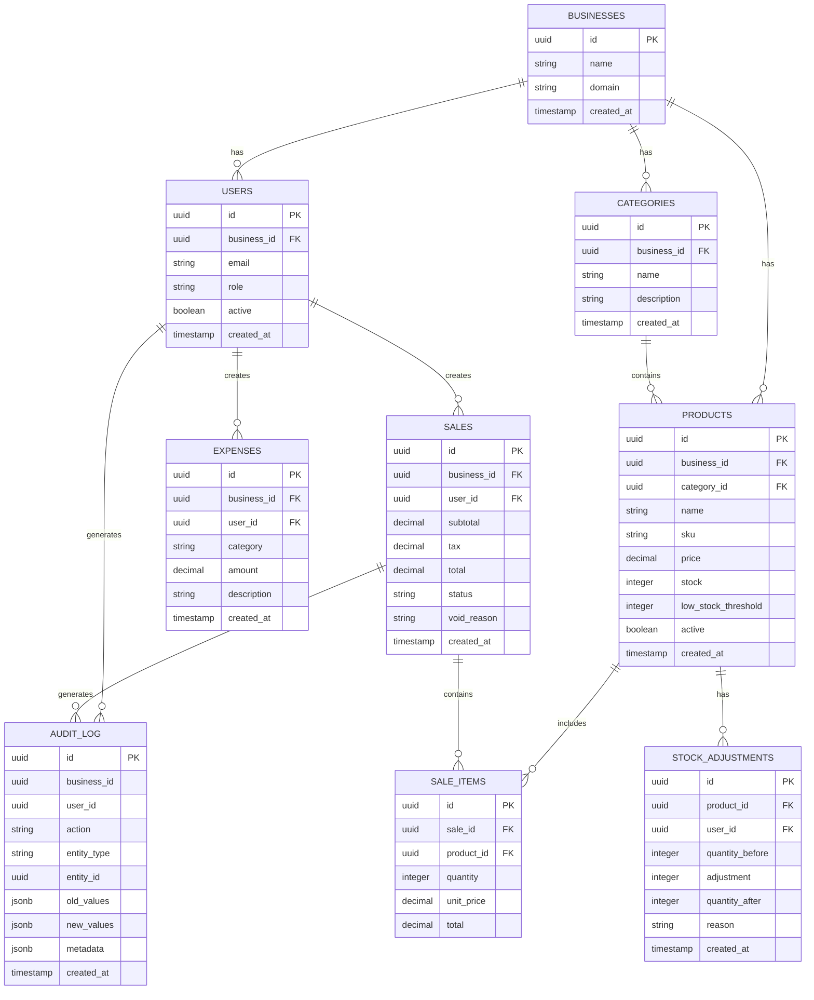

# Database schema

## Core entities



`audit_log` is the one table that carries a tenant **without** a foreign key to it, and
carries the actor without a foreign key to `profiles`. Both are deliberate — see
[Audit log](#audit-log).

## Multi-tenant isolation

Every tenant-owned table includes a `business_id` foreign key, and Row-Level Security
filters queries by the authenticated user's business. Join tables (`sale_items`,
`stock_adjustments`) deliberately omit it and resolve tenancy through their parent, so
a tenant key can never drift between rows.

### Do not read `business_id` from the JWT

```sql
-- WRONG. Supabase does not put business_id in the JWT unless you build a
-- custom access-token hook. Without one this matches zero rows and every
-- query returns nothing, with no error.
CREATE POLICY products_own ON products
    FOR ALL USING (business_id = auth.jwt() ->> 'business_id');
```

Resolve the tenant through a `SECURITY DEFINER` function instead. `SECURITY DEFINER`
is required, not stylistic: `profiles` has its own RLS, so a policy on `profiles` that
queries `profiles` would recurse infinitely.

```sql
-- CORRECT — this is what migration 001 ships.
CREATE FUNCTION public.current_business_id()
RETURNS uuid
LANGUAGE sql
STABLE
SECURITY DEFINER
SET search_path = public
AS $$
    SELECT business_id FROM public.profiles WHERE id = auth.uid()
$$;

CREATE POLICY products_own ON public.products
    FOR ALL USING (business_id = public.current_business_id());
```

The same applies to trigger functions that write to a protected table. A
`SECURITY INVOKER` trigger is evaluated against the calling user's RLS policies, so a
trigger that inserts into a table whose `INSERT` policy is closed will have its own
write rejected. `audit_row_change()` is `SECURITY DEFINER` for that reason.

## Roles

A profile carries one of three roles. The legacy POS had no roles at all — only nine
module flags, set per employee and enforced in the UI — so this matrix is new, and the
database is the only thing enforcing it.

| | cashier | supervisor | admin |
|---|---|---|---|
| take a sale, record an expense | yes | yes | yes |
| record a stock adjustment | yes | yes | yes |
| create or edit products, categories, payment methods, customers | no | yes | yes |
| change a price or a cost | no | yes | yes |
| correct an expense | no | yes | yes |
| void a sale (reason required) | no | yes | yes |
| delete a product, expense, category, payment method or customer | no | no | yes |
| set another member's role | no | no | yes |
| rename the business | no | no | yes |
| edit a completed sale or one of its lines | no | no | no |
| delete a sale, a stock adjustment, or an audit row | no | no | no |
| read the audit log | own entries | own + their cashiers | the whole trail |
| close the business | server only | server only | server only |

Four rules carry most of it:

- **A completed sale is a fact.** It is written once, and afterwards the only permitted
  change is the void, which needs a reason. Nobody edits a total or a line quantity.
- **Stock is corrected by adding a row, never by removing one.** `stock_adjustments` has
  no `DELETE` grant at all, and its `reason` is `NOT NULL`.
- **Price and cost are `supervisor` and up.** Row-level security cannot see columns, so
  `guard_product_pricing()` enforces this.
- **Nobody changes their own role**, not even an admin. That is the legacy self-escalation
  — anyone who could edit an employee could tick every permission box on their own record.

Two enforcement details worth knowing before you write a trigger:

- A refused `UPDATE` or `DELETE` is **filtered, not refused**: the statement succeeds and
  affects zero rows, raising nothing. Only a failed `INSERT` trips the `WITH CHECK`. Tests
  have to assert on `ROW_COUNT` or they will read a denial as a success.
- The role-checking triggers are `SECURITY INVOKER` on purpose. Inside a `SECURITY DEFINER`
  function `current_user` is the function owner, so a definer trigger cannot tell a client
  from the server. `service_role` and a direct `DATABASE_URL` connection bypass
  row-level security anyway, so the matrix is enforced at the client edge and the server
  is trusted — a rebuild or an import may correct rows in place.

## Audit log

`audit_log` is append-only, and the database is what enforces it: `audit_log_immutable`
refuses `UPDATE` and `DELETE` row by row, `audit_log_no_truncate` refuses `TRUNCATE`, and
the grants are narrowed to `SELECT` for `authenticated` and `service_role`. It holds for
the owner and for the service key too — a trail the server can edit is not a trail.
Migration `20261010000000` is what makes it so.

### Every sensitive table is covered

An `AFTER INSERT OR UPDATE OR DELETE` trigger calls `audit_row_change()` on each of:

`businesses`, `profiles`, `categories`, `payment_methods`, `products`, `customers`,
`sales`, `sale_items`, `expenses`, `stock_adjustments`

The tenant comes off the row itself, never from `current_business_id()`, because that is
`NULL` whenever the write is made with the service key — the entry would be attributed to
nobody and become invisible to every tenant. `stock_adjustments` and `sale_items` carry no
`business_id`, so it is resolved through `products` and `sales`.

### What an entry records

| Field | Meaning |
| --- | --- |
| `action` | The operation, named: `products.insert`, `sales.void`, `stock.adjust` |
| `old_values`, `new_values` | The row before and after, filtered by `audit_safe_values()` |
| `metadata.source` | `db_trigger` — the trigger is the only writer |
| `metadata.operation` | The raw `TG_OP`, which `action` is derived from |
| `metadata.actor_type` | `user`, or `system` when there is no JWT and no actor |
| `metadata.sensitive` | True for a `DELETE`, a `sales.void` or a `stock.adjust` |

### No secrets, by allowlist

`audit_safe_values()` copies an explicit list of scalar columns and drops everything else:
an unknown column, a nested object and an array are excluded by default. That direction
matters — a denylist has to name the secret before it exists, and the trail is the one
table from which nothing can ever be deleted. `audit_row_change()` is `SECURITY DEFINER`
because the trigger writes to a table whose `INSERT` is closed to every role;
`audit_safe_values()` is the plain immutable helper it calls.

### Evidence outlives what it describes

`audit_log` has **no** foreign keys. The original `ON DELETE CASCADE` from `businesses` and
`ON DELETE SET NULL` from `profiles` meant closing a tenant, or merely removing one person,
rewrote or erased the record of what they did. Both were dropped, so an entry survives its
tenant and keeps the actor it names. This is why closing a business purges its catalogue and
ledger but keeps the trail, and it is asserted in `scripts/verify-schema.sql`.

### Who reads it

| Role | Access |
| --- | --- |
| Admin | The whole trail of their own business |
| Supervisor | Their own actions, plus those of the cashiers in the business |
| Cashier | Only entries where they are the actor |

`audit_log_scoped` enforces this, and also requires an active profile. Full access is still
bounded by the tenant: no admin reads another business's log. An entry with no
`business_id` — a failed login for an address that never authenticated, for example —
belongs to no tenant and is visible only to the server, not to a business admin.

### API-origin entries

Some events change no row: a login, a logout, a backup, a sensitive request that was refused
before it touched anything. The API appends those through `audit_append()` rather than
through an `INSERT` grant. That matters because a grant is a writer that can forge any entry
it likes, while the function keeps the same rules as the trigger: `audit_safe_values()` on
the values, its own metadata allowlist, `source` and `actor_type` derived rather than
supplied, and `sensitive` forced on for a void, an adjustment or a delete.

Functions are executable by `PUBLIC` by default, so the migration revokes `EXECUTE` from
`anon` and `authenticated` and grants it to `service_role` alone. A browser cannot forge
the record of what its user did.

| Column | Value the API writes |
| --- | --- |
| `metadata.source` | `api` — no caller can claim `db_trigger` |
| `metadata.actor_type` | `user` when `user_id` is set, `system` otherwise |
| `metadata.request_id` | Correlates with the `http_request` line in the log bundle |
| `metadata.outcome` | `success`, `denied` or `error` |
| `metadata.sensitive` | Raised by the operation; a caller can add it but not remove it |

## Indexes

| Table | Index | Purpose |
| --- | --- | --- |
| `users` | `idx_users_business` | Multi-tenant filtering |
| `products` | `idx_products_business` | Multi-tenant filtering |
| `products` | `idx_products_category` | Category lookups |
| `sales` | `idx_sales_business_date` | Date-range queries |
| `sales` | `idx_sales_user` | User-specific queries |
| `audit_log` | `idx_audit_log_user` | Entries by actor |
| `audit_log` | `idx_audit_entity` | Entity audit trail |
| `audit_log` | `idx_audit_business_created` | A tenant's trail, time-based |
| `audit_log` | `idx_audit_cursor` | Keyset pagination, newest first |
